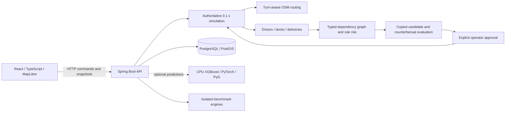

# CascadeShield AI

CascadeShield AI is a logistics digital twin for studying road disruptions, cascading operational delays and preventive interventions. Simulated trucks move on a real OpenStreetMap road network in central Chennai, sharing drivers, warehouses, docks and delivery deadlines.

**Real geography. Simulated operations. Research results, not observed freight performance.** Milestones 1–4 have implementation and recorded verification evidence. Milestone 4 trained XGBoost and graph neural networks, but **did not demonstrate better downstream prevention than the strongest tested rule baseline**. The default application uses deterministic estimates and works without ML packages or training.

## Implementation status

| Milestone | Implemented scope | Evidence |
| --- | --- | --- |
| 1 | Chennai routing, truck movement, road incidents, manual intervention, persistence/replay | [Executed results](reports/MILESTONE_1_RESULTS.md) |
| 2 | Drivers, warehouses, docks/queues, deliveries, typed dependency graph, risk propagation and approval | [Executed results](reports/MILESTONE_2_RESULTS.md) |
| 3 | Isolated counterfactual rollouts, B0–B4, persistent Benchmark Lab and 260 recorded policy runs | [Executed results](reports/MILESTONE_3_RESULTS.md) |
| 4 | Frozen XGBoost/static GNN/temporal GNN, CPU inference, guarded advice and 440 policy runs/11 methods | [Executed results and negative findings](reports/MILESTONE_4_RESULTS.md) |

Milestone 5 is planned and is not implemented in this release. Autonomous LLM agents, reinforcement learning, blockchain and field validation are also not implemented. Benchmark Lab exposes B0–B4. The separate M4 B5 study is research code/results, not an additional default Lab policy catalog.

## Windows quick start: Download ZIP

1. Install and start [Docker Desktop for Windows](https://docs.docker.com/desktop/setup/install/windows-install/), using its **Linux containers** engine. Follow Docker's Windows/WSL 2 prerequisites. The supported host workflow is Windows 10/11 with Windows PowerShell 5.1 or later. Allow several GB of disk for images/build caches and sufficient Docker memory for Java/PostGIS; optional ML uses additional memory/storage. Internet is needed for the initial build.
2. On [GitHub](https://github.com/Rattishaids/CascadeShield-AI), choose **Code → Download ZIP**. Extract the whole archive into a writable folder. Open Windows PowerShell in the extracted folder containing this README.
3. Run the following. Default startup needs **no host Git, Python, Java, Node.js, GPU, existing database or historical research dataset**.

```powershell
powershell -ExecutionPolicy Bypass -File .\scripts\check_prerequisites.ps1
powershell -ExecutionPolicy Bypass -File .\scripts\setup.ps1
powershell -ExecutionPolicy Bypass -File .\scripts\start_simulator.ps1
```

Open **http://127.0.0.1:5173**. Backend health: **http://127.0.0.1:8080/api/health**. Keep Docker Desktop running. Setup builds the images and creates ignored local configuration with a random database password. Startup initializes a separate PostgreSQL/PostGIS database, applies migrations, imports the included Chennai graph and loads a small **SIMULATED DEMO** only into an empty draft. It does not import unrelated research cohorts or replace an existing fleet.

The first build downloads container images and pinned project dependencies and can take several minutes. Resolve failed network downloads and rerun setup; do not disable TLS validation. [Release verification](reports/RELEASE_VERIFICATION.md) records the actual isolated clean-export test and environment limits. An app pass on the test host is not a claim that another physical computer or OS was tested.

Stop services while retaining saved state:

```powershell
powershell -ExecutionPolicy Bypass -File .\scripts\stop_simulator.ps1
```

## Simulated demonstration

The seeded demo has two trucks, separate drivers, one warehouse, a shared 300-second dock and two deliveries on connected Chennai roads. If starting without auto-seeding, load it with:

```powershell
powershell -ExecutionPolicy Bypass -File .\scripts\load_demo.ps1
```

The loader refuses an existing fleet. To keep your work, save/export its scenario and use a separate Compose project/volume for a fresh demo. Reset restores original definitions; it does not delete trucks/resources.

1. Refresh the browser. Use **Start simulation**, **Pause**, **Resume**, the **30 seconds** step button and 1×/2×/5×/10× controls. Watch backend-owned positions move along connected roads. Select a truck to inspect its route.
2. To trigger an incident, click a physical road segment ahead of a truck and inject a **closure** or **slowdown** in Disruption control. Inspect affected trucks, ETA and Continue/Wait/Reroute comparisons. A truck already on a newly closed edge finishes it before holding safely.
3. To reproduce the dock cascade from a freshly seeded draft, inject a **90-second closure at simulation time 0 on the first segment of DEMO-A's route**, using the identifier and nearby coordinate printed by the loader. Select **Road closure** and enter **1.5** in **Duration · simulation minutes**, then inject it before starting. DEMO-B departs at 200 seconds and reaches the segment after reopening. The delayed A occupies the shared dock when B arrives, so B queues and its dock-completed delivery is late. Inspect **Operational dependencies**, dock timings and separate forecast/realized timelines. The loader prints this scenario's route baseline and delivery deadline. Do this before testing a reroute if you want to observe the untreated cascade.
4. For an intervention, pause an active non-replay run with a current candidate. The ordinary recommendation panel permits explicit feasible-action approval. The **ML-assisted operator review** panel also works with **Rule baseline**: compare actions, request review, enter a local operator ID, explicitly approve, then execute. State changes invalidate stale approvals; they are single use. Viewing advice does not execute it. The local operator ID is an audit label, not production authentication.
5. Use **Scenarios** to save/export the inputs and recorded command schedule. Replay restores them paused; resume/step to execute. Backend restart restores a stationary checkpoint, so downtime never advances trucks.

These are deliberately constructed simulated examples, not field freight records or a prevention-effectiveness experiment. To create other routes in an editable draft, use **Add truck** and map start/destination selection, or the 10/20-truck demonstration buttons. Configure resources below the map for dock-assigned deliveries; unassigned demo-fleet-button trucks retain road-only behavior.

## Configuration and database

Scripts resolve paths from the extracted project, not the original developer's directory. `setup.ps1` creates a private root `.env`; [.env.example](.env.example) documents the settings. Never commit `.env`. The default Compose project is `cascadeshield-demo`, with dedicated volume `cascadeshield-demo_demo_database`. Database credentials are randomly generated locally. The release does not use a developer's existing database or private dump.

Default localhost ports are frontend **5173**, backend **8080**, PostgreSQL **55433**, and optional ML **8090**. To use different ports or an isolated project, choose settings when creating a new environment file:

```powershell
powershell -ExecutionPolicy Bypass -File .\scripts\setup.ps1 -EnvFile .env.second -ProjectName cascadeshield-second -FrontendPort 5174 -BackendPort 8081 -PostgresPort 55434 -MlPort 8091
powershell -ExecutionPolicy Bypass -File .\scripts\start_simulator.ps1 -EnvFile .env.second
powershell -ExecutionPolicy Bypass -File .\scripts\stop_simulator.ps1 -EnvFile .env.second
```

Generation flags apply to a new environment file. Setup/start preserve a populated database; use the same project configuration to reopen saved work. `-NoDemo` suppresses initial demo seeding. Do not remove volumes you want to retain.

The supplied PostgreSQL 17/PostGIS 3.5 image initializes the spatial extension. Spring Boot Flyway applies V1 simulator, V2 operational/approval and V3 benchmark migrations, then validates/persists the included graph in `cascadeshield_sim`. No historical research tables are needed. Inspect service logs with:

```powershell
docker compose --env-file .env logs --tail 100 backend
docker compose --env-file .env logs --tail 100 database
```

## Optional trained predictions

The small frozen model bundle is included as ordinary repository files. No training is needed. Its optional **CPU** service downloads substantially larger Python/PyTorch packages during image build and is separate from default setup:

```powershell
powershell -ExecutionPolicy Bypass -File .\scripts\setup.ps1 -WithML
powershell -ExecutionPolicy Bypass -File .\scripts\start_simulator.ps1 -WithML
```

In **Learned predictions**, select XGBoost, XGBoost without graph summaries, static GNN or temporal GNN and predict the current snapshot. Provider/version, targets, intervals, latency and domain warnings are explicit. Inference is read-only. If the service is missing, invalid or slow, the backend labels deterministic fallback and leaves trained probabilities/intervals unavailable. These trusted-local services do not provide production authentication.

The models learned simulated outcomes. The completed frozen study assessed **440 policy runs across 11 policies**. Its actual results include:

| Predictor | Held-out road-arrival ETA MAE |
| --- | ---: |
| XGBoost | 59.189 s |
| Static GNN | 115.499 s |
| Temporal GNN | 94.717 s |
| Matching conditional rule baseline | 77.571 s |

| Operational policy | Mean delivery SLA violation rate |
| --- | ---: |
| B3 | 47.389% |
| B4 | 49.034% |
| B5 XGBoost | 49.034% |
| B5 static GNN | 49.034% |
| B5 temporal GNN | 51.664% |

Static GNN had a better offline SLA Brier score, but **no downstream operational improvement was demonstrated**. XGBoost tied B4 and its same-algorithm rule control on SLA; counterfactual XGBoost added computation without an isolated SLA gain. See the [full M4 report](reports/MILESTONE_4_RESULTS.md) for matched comparisons, intervals, failures and limits. Exposed final test seeds cannot be reused as fresh holdout data after tuning.

`scripts/start_ml.ps1` starts the same ML-enabled container stack with existing state preserved and demo seeding disabled. `scripts/stop_ml.ps1` stops only inference, leaving the simulator to use explicit deterministic fallback. Both accept the same `-EnvFile` option as simulator startup. No trained weights are fitted or changed by these commands. The inference host port binds to `127.0.0.1`; public unauthenticated service deployment is outside this release.

## Architecture and technology



| Layer | Implementation |
| --- | --- |
| Frontend | React 19, TypeScript, Vite, MapLibre GL; exact versions in `package-lock.json` |
| Backend | Java 21, Spring Boot 3.5.16, Maven, JGraphT 1.5.3 |
| Persistence | PostgreSQL 17/PostGIS 3.5, Flyway, transactional state/events/approvals |
| Simulation | Fixed 0.1-second backend steps, directed roads, resource calendars and sequential dock service |
| Research tools | Python acquisition, ETL, quality checks, graph conversion, benchmarks and reporting |
| Optional ML | XGBoost 3.1.3, PyTorch 2.7.1, PyG 2.7.0, CPU inference and frozen manifest |

Container definitions and dependency locks/pins specify the exact build. Host Java/Node/Python are needed only for optional native development. Linux/macOS users can use the Compose services directly, but no unexecuted platform verification is claimed. [Simulator developer guide](simulator/README.md) describes state, persistence and API boundaries.

## Benchmark Lab

Choose a preset, seeds and small policy selection in **Benchmark Lab**, then run a comparison. Independent engines preserve the live fleet, persist jobs and export CSV/JSON. Do not restart during a running job; interruption is recorded as failure. Counterfactual rollouts execute actual simulated movements and queues, so larger comparisons take longer.

| Method | Behavior |
| --- | --- |
| B0 | No intervention; physical/resource constraints still execute |
| B1 | Reactive whole-remaining-route planning using projected road arrival |
| B2 | Local repair around the first known affected road segment |
| B3 | Graph/rule heuristic over copied candidate estimates |
| B4 | Current-knowledge executed counterfactual alternatives and feasible action selection |
| B5 study | Separate frozen learned-score variants, controls and graph/counterfactual ablations; M4 research results |

Full and equal-action comparisons answer different questions. Trigger rules, action availability, horizons and computation affect results; there is no global routing/scheduling optimum or universal winner claim. Read the [benchmark protocol](docs/BENCHMARK_PROTOCOL.md) and [counterfactual engine](docs/COUNTERFACTUAL_ENGINE.md).

## Data provenance and licenses

The included `data/processed/chennai_osm/road_graph.json` is an OpenStreetMap-derived database with SHA-256 `c943bac278192042b22342d8e1be898cc68512fb936e314633645bc3e0304e60`. Its accompanying `roads.geojson` supplies the displayed physical segments; both required files ship in the archive (about 13.9 MB combined). The network contains 12,386 nodes, 23,907 directed edges, 14,147 physical segments and 10 supported turn restrictions within `[13.04, 80.24, 13.095, 80.29]`. Source timestamp: `2026-10-09T05:33:21Z`. These are ordinary tracked files, available in Download ZIP without Git LFS. Routing needs no external map download.

**© [OpenStreetMap contributors](https://www.openstreetmap.org/copyright).** The derived road database is licensed under [Open Database License 1.0](https://opendatacommons.org/licenses/odbl/1-0/). Preserve attribution/license/source notices and comply with applicable ODbL adapted-database/share-alike requirements. This data license does not automatically license unrelated application source code. See [Chennai provenance](reports/CHENNAI_NETWORK.md) and [third-party notices](THIRD_PARTY_NOTICES.md).

The raw GB safety, Cambridge, Brazil e-commerce, Porto/NYC taxi and weather collections are excluded. Useful metadata and acquisition/preparation instructions remain, subject to source licenses/authentication. Independent countries/time ranges are not combined as Chennai logistics observations. Most road speeds, operational timing, weather effects and costs are simulation assumptions. No real freight telemetry or customer records are bundled.

## Testing and research reproduction

[Release verification](reports/RELEASE_VERIFICATION.md) records current passes/failures, exact commands and clean-export results. Historical milestone counts describe their original executions, not a new run on another computer.

Backend/frontend tests can run in build-tool containers without host Java/Node:

```powershell
docker run --rm --mount "type=bind,source=$((Get-Location).Path),target=/workspace" -e SIMULATOR_GRAPH_PATH=/workspace/data/processed/chennai_osm/road_graph.json -w /workspace/simulator/backend maven:3.9-eclipse-temurin-21 mvn -B test
docker run --rm --mount "type=bind,source=$((Get-Location).Path),target=/workspace" -w /workspace/simulator/frontend node:22-bookworm-slim sh -c 'npm ci && npm test && npm run build'
```

These write build outputs into the extracted directory. Integration/browser harnesses can replace simulated fleets; use a separate test project/database. Host Python/browser prerequisites and exact release checks appear in the verification report. The optional Maven relay (`-UseMavenRelay`) needs host Python 3.11+ and accesses only official Maven Central; ordinary setup does not need it.

For optional release verification, create a separate Python 3.11 environment and install the pinned test tools. Point integration tests at an isolated environment file, never at an operator demonstration:

```powershell
py -3.11 -m venv .venv-release-test
.\.venv-release-test\Scripts\python.exe -m pip install -r requirements-release-test.txt
.\.venv-release-test\Scripts\python.exe -m playwright install chromium
.\.venv-release-test\Scripts\python.exe scripts/run_release_python_tests.py --report .runtime/python-release-tests.json
.\.venv-release-test\Scripts\python.exe scripts/test_release_integration.py --suite simulator --env-file .env.second --report .runtime/simulator-integration.json --allow-reset
.\.venv-release-test\Scripts\python.exe scripts/test_release_integration.py --suite operations --env-file .env.second --report .runtime/operations-integration.json --allow-reset
.\.venv-release-test\Scripts\python.exe scripts/test_release_integration.py --suite benchmark --env-file .env.second --report .runtime/benchmark-integration.json --allow-reset
.\.venv-release-test\Scripts\python.exe scripts/test_release_browser.py --ui http://127.0.0.1:5174 --api http://127.0.0.1:8081/api --report .runtime/browser-release-tests.json --expect-ml off
```

The Python runner reports seven original-source artifact tests as **not available** when the excluded raw research collections are absent. It runs the 26 applicable parser, graph-conversion and statistics checks; it does not invent source files or count unavailable tests as passes. The fresh database also has no original version-1 saved scenario, which the integration adapter reports separately. Optional ML/audit contracts use `run_release_python_tests.py --ml` in an environment with the documented CPU ML dependencies.

This is a curated release, not the entire research workspace. Large corpora, raw benchmark traces, training intermediates and private environments are omitted. Historical commands may require those artifacts, original environment names or the historical source freeze. Read [release research scope](docs/RELEASE_RESEARCH_SCOPE.md) before running them. An app installation does not establish that every historical experiment can be regenerated from this ZIP alone. Missing/restricted data must be reported, never fabricated or replaced silently.

## Troubleshooting

| Symptom | Action |
| --- | --- |
| PowerShell blocks scripts | Use the shown per-command `-ExecutionPolicy Bypass`; no permanent policy change is needed. |
| Docker missing/daemon unavailable | Install/start Docker Desktop, select Linux containers and rerun the prerequisite check. |
| Java, Maven, Node.js or Python missing | Default container startup does not need host copies; optional native development does. |
| Ports occupied | Use a new environment/project with different ports as shown above; use the URLs printed by startup. |
| PostgreSQL unavailable | Inspect Docker/database health and logs; keep the volume. Do not delete state to solve a connection error. |
| PostGIS/migrations absent | Use the supplied PostGIS image and startup initialization; inspect backend/database logs. Historical ETL does not initialize the app. |
| Chennai graph missing/hash mismatch | Re-extract the complete archive and restore the included graph; no original developer directory is needed. |
| Image/npm/Maven download failure | Check network/proxy/certificates for official registries/repositories; resolve access and rerun setup. |
| Roads appear but basemap is absent | Background map services may be blocked. Local roads/routing remain available. |
| Demo loader refuses existing state | Save/export it and create a separate project/volume for a fresh demo; reset does not delete definitions. |
| ML fallback shown | Launch with `-WithML`, inspect service warnings/logs and verify bundle files. The default app works without ML. |
| Approval stale/rejected | Pause a non-replay active run and request a new comparison/review after state changes. |

## Repository layout

```text
simulator/backend/           Java API, simulation, routing, tests and migrations
simulator/frontend/          React UI, map, operational panels, npm lockfile/tests
scripts/                    Release entry points and optional research utilities
data/processed/chennai_osm/  Required ODbL graph
data/metadata/              Dataset manifests and provenance
models/milestone4/v1/       Optional frozen CPU-compatible models
ml/                         Model features, architectures, inference/training
config/                     Acquisition and research protocol configuration
docs/                       API, graph, methodology and release scope
reports/                    Curated milestone, quality and release evidence
tests/                      Python acquisition/schema/ML contracts
```

This is trusted local research software. It has bounded geography, configured driver windows, mostly assumed speeds, under-covering learned ETA intervals, no production authentication or navigation certification, and no observed freight effectiveness validation. Negative research results remain part of the release.
