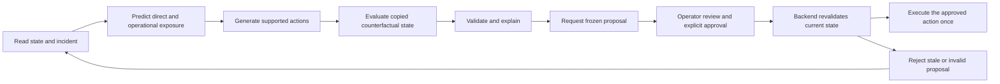

# Future agentic workflow boundary

Milestone 2 prepares typed local tool contracts and backend approval checks. It does not install LangGraph, run an LLM, use a paid AI provider or allow an autonomous tool to move a truck. Backend simulation and constraint enforcement remain authoritative.

## Intended workflow

The future LangGraph process should be a client of these contracts. Read tools can run without a write capability. Proposal creation records a reviewable action; operator approval must remain a distinct UI/backend step. Action execution accepts a recorded approved proposal ID rather than unrestricted text generated by a model. The approval must bind the exact candidate, state fingerprint, source version and constraint/evaluation facts.

LangGraph's documented [interrupt primitive](https://reference.langchain.com/python/langgraph/types/interrupt) can pause a future workflow for human input. That pause alone does not grant backend permission: a resumed graph still needs the persisted backend approval, current-state validation and single-use execution. The current milestone implements the local contracts, not the LangGraph runtime.

## Tool contracts

| Tool | Typed input | Read/review output | Boundary |
| --- | --- | --- | --- |
| `get_current_simulation_state` | None | Current `Models.State` snapshot | `GET /api/state`; no writes |
| `inspect_incident` | Incident ID in path | Actual incident, directly affected trucks and attributed resource risks | `GET /api/incidents/{id}`; no inferred incident records |
| `get_affected_resources` | Optional `incidentId` query | Thresholded explicit operational nodes, edges and attributed risks | `GET /api/operations/affected?incidentId={id}`; provenance retained |
| `predict_cascade` | No body; reads current backend snapshot | `AiModels.PredictionBatch` | `POST /api/ai/predict`; conditional ETA is distinct from unknown operational ETA |
| `generate_candidate_actions` | Truck ID in path | `CandidateBatch` with fingerprint and recommendation ID | `POST /api/ai/candidates/{truckId}`; Continue/Wait/Reroute only |
| `evaluate_counterfactual` | Exact `CandidateAction` JSON body | `Evaluation` from copied state | `POST /api/ai/counterfactual`; no real movement or experimental outcome |
| `validate_constraints` | Exact `CandidateAction` JSON body | `ValidationResult` with blocking errors and planning warnings | `POST /api/ai/validate`; stale/altered/unsupported candidates fail |
| `explain_recommendation` | Exact `CandidateAction` JSON body | Revalidated structured `Explanation` and calculated facts | `POST /api/ai/explain`; `GET /api/ai/recommendations/{truckId}` additionally returns the selected comparison |
| `request_operator_approval` | Exact `CandidateAction` JSON body | Persisted proposal ID, fingerprint and evaluation | `POST /api/ai/approvals`; paused/draft simulation required, no execution |
| `execute_approved_action` | Approved proposal ID in path, empty body | Actual authoritative state and event audit | `POST /api/ai/approvals/{id}/execute`; approval and revalidation required |

The service/controller remains the source of exact request bodies. Typed payloads use `cascadeshield.ai/1.0`; snapshot exports use a separate schema. `GET /api/ai/approvals` lists up to 100 recent persisted proposals for the current run. Request creates `REQUESTED`; a separate operator call `POST /api/ai/approvals/{id}/approve` with `{"approvedBy":"local-operator"}` records `APPROVED`; successful execution records `EXECUTED`. Request/approval audit is persisted separately and does not change simulation state or its fingerprint. Only the execution command changes the simulated run.

The future LLM must not receive the approval endpoint as an available tool. Approval requires an explicit operator review step. The current local `approvedBy` label is an audit label, not authenticated production identity. Authentication and actor authorization are later deployment requirements. The existing `/api/decisions` path remains available for the dashboard's direct operator action; a future agent must use the approved-proposal workflow.

## Validation and authority

Every candidate is generated from actual state with its deterministic identity, real road recommendation ID, exact fallback `Source` record and SHA-256 fingerprint of the full serialized state. Changing clock, position, route, incident, assignment, scenario identity, simulation audit events or resource constraints invalidates the previously evaluated candidate. The backend rechecks candidate identity and constraints when a proposal is requested, checks run identity and fingerprint during approval, and rechecks the approved record, fingerprint and constraints at execution. Request, approval and execution require a DRAFT or PAUSED state and reject recorded replay. Saving a scenario or changing speed also changes the state fingerprint, so finish those edits before requesting review.

The runtime enforces physical connectedness, speed, closure entry, turn restrictions, truck capacity, driver availability/ownership/shift and dock hours/occupancy. Future tools cannot bypass those rules by asserting that an action is feasible. Forecast conflicts are disclosed warnings where an otherwise safe intervention can still improve the situation; a model must not interpret that as permission to overwrite schedules or driver availability.

Approved wait/reroute execution produces the same command/event path as a manually approved simulation intervention. It does not teleport a truck or substitute frontend movement. Replayed scenarios lock new operator mutations until reset. Reusing a consumed proposal is rejected with a conflict instead of executing twice. A proposal tied to another run or a stale fingerprint is rejected; current proposals have no wall-clock expiry. Restart recovery that changes the simulation state also invalidates a frozen proposal. Durable retry handling and explicit time expiry remain future controls.

Execution prepares a copied engine, then commits approval consumption and its checkpoint/events together before publishing the copy. Checkpoint or commit failure leaves the previous authoritative engine and pending event buffer untouched. A retry must still inspect the durable approval status and pass the same current-state checks; it cannot assume that a network error means approval was not consumed. The transaction regression tests verify the failure and publication ordering with transactional doubles.

## Required later controls

Before integrating an LLM, add an authenticated operator identity and production authorization model, a durable agent checkpointer, explicit proposal expiry, retry/idempotency behavior, bounded tool-call budgets and a review UI that shows the exact resource consequences. Retain the network/scenario/version and provider provenance in every trace. Human edits must create a new validated proposal rather than altering an already approved record.

Give an LLM only the supported tool schema and relevant finite state snapshot. Treat names, incident text and external retrieval as untrusted data, not authority to execute instructions. Validate structured output against the typed schema, reject nonfinite/unbounded values, and handle inference failures by exposing the documented fallback source. No generated narrative may fabricate measured truck arrival, delivery completion, forecast success or real freight relationships.

The present agentic boundary has no driver/dock swaps, automatic assignment rewrites, stochastic planning, autonomous approval or external model call. Expanding action types requires backend implementation, copied-state evaluation, constraint/replay tests and explicit operator approval semantics first. Work stops at the Milestone 2 architecture and local deterministic demonstration.
